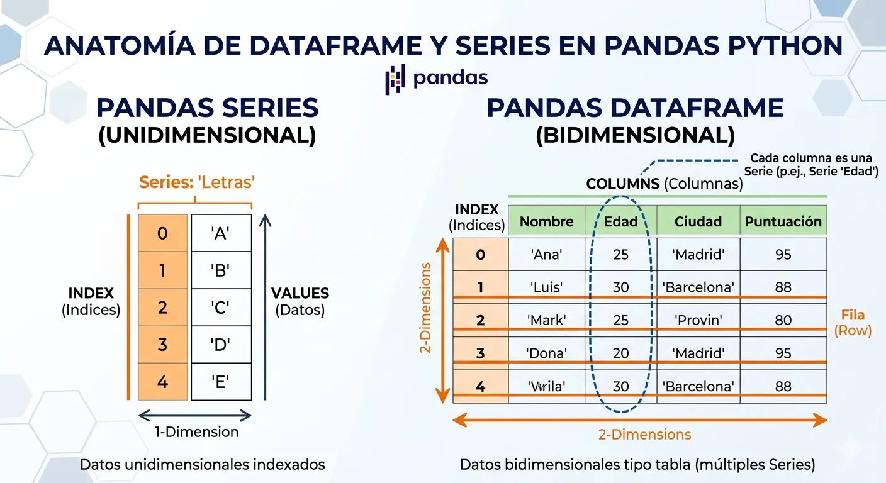
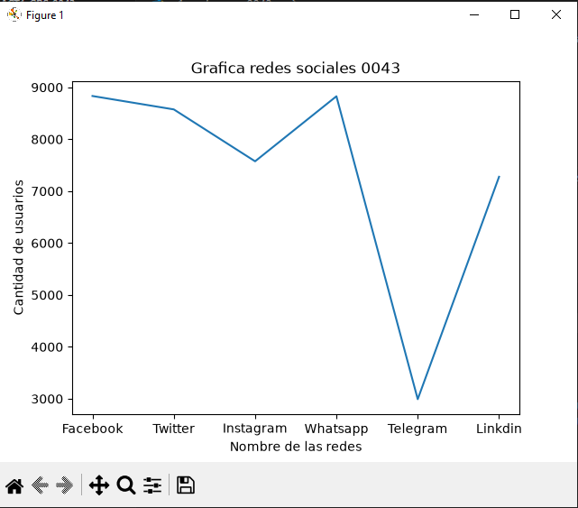
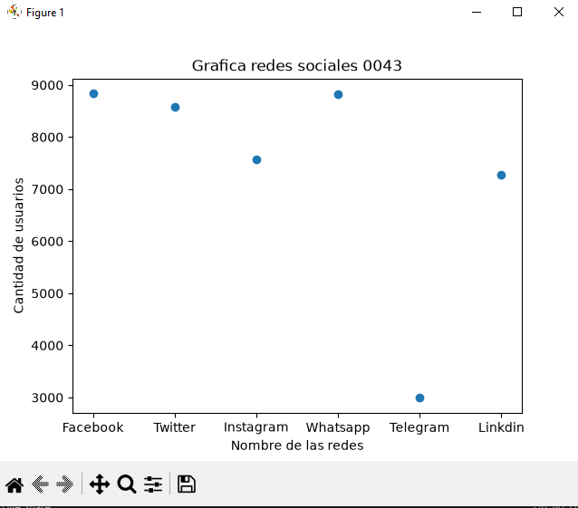
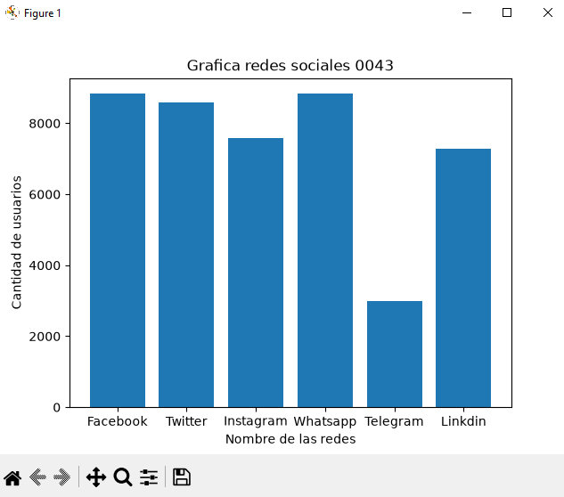
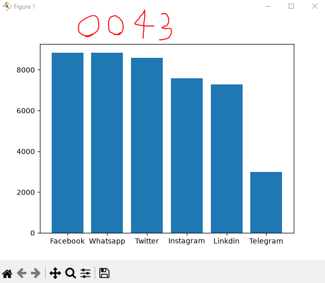
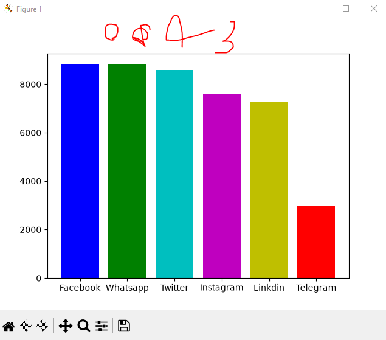
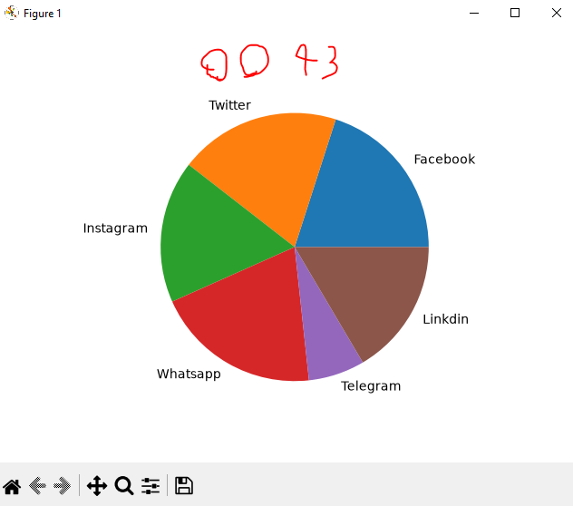

## dataframe o marco de datos pandas

## Redes sociales a nivel mundial

## grafica lineal de redes sociales

## grafica puntos

## grafica barras

## grafica de barras del mas grande al mas chico descendentes

## coloreando la grafica

## Grafica de pastel o pie
